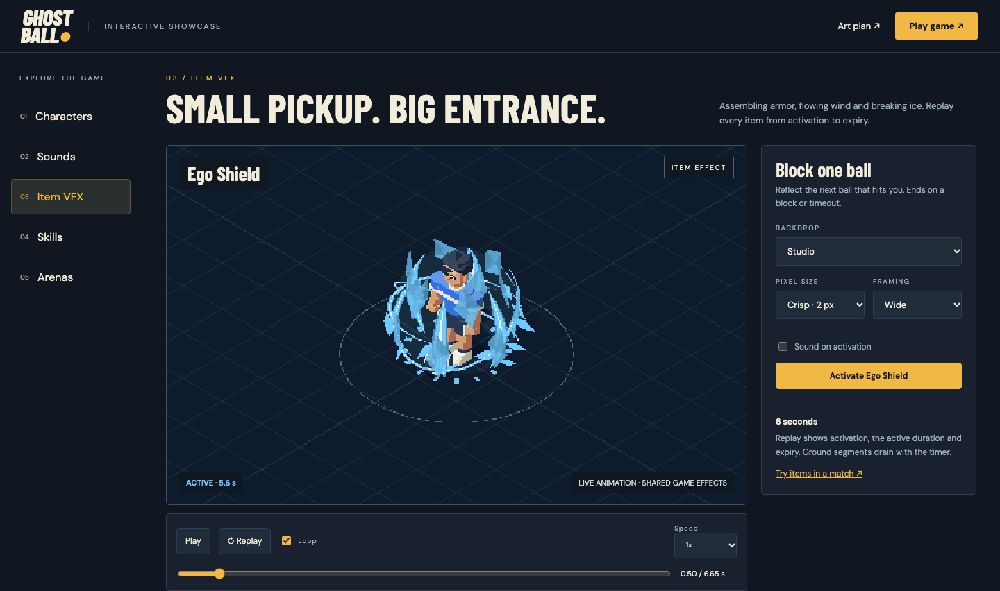
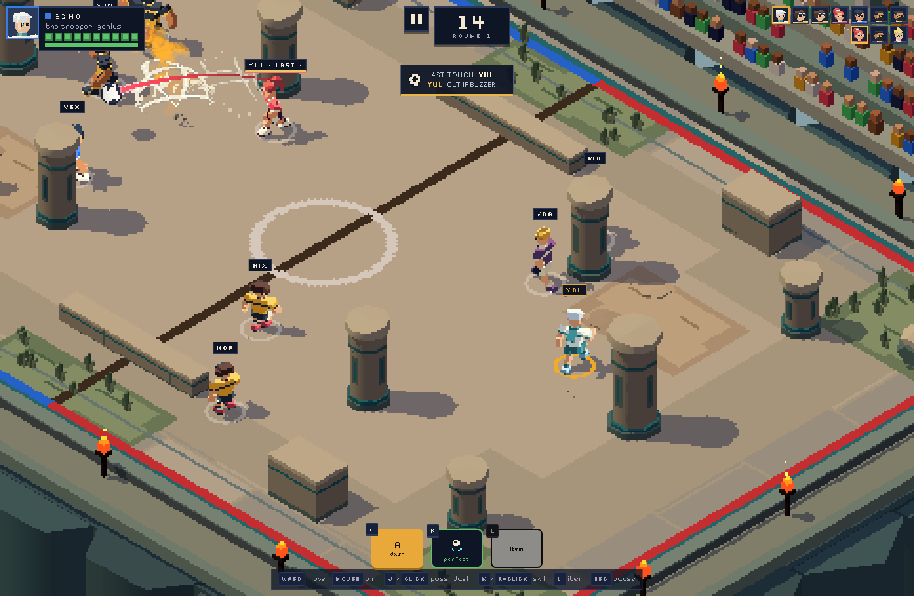
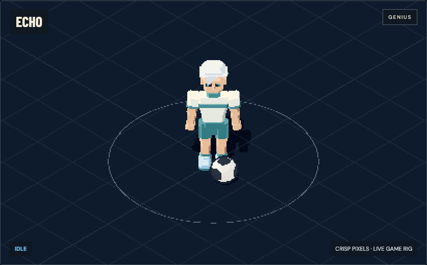
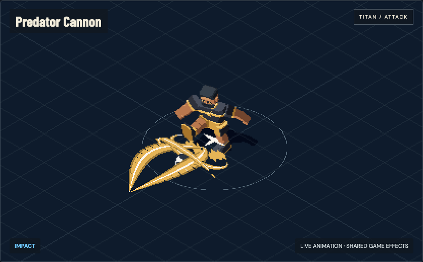
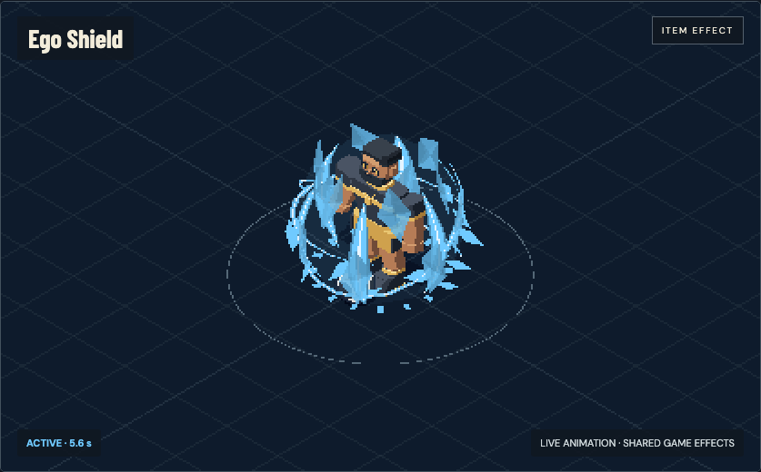
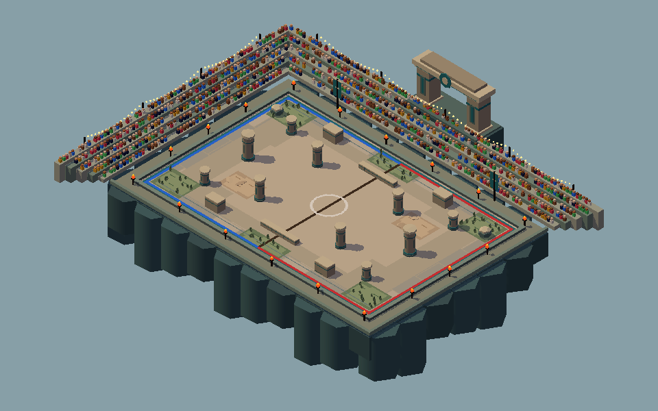
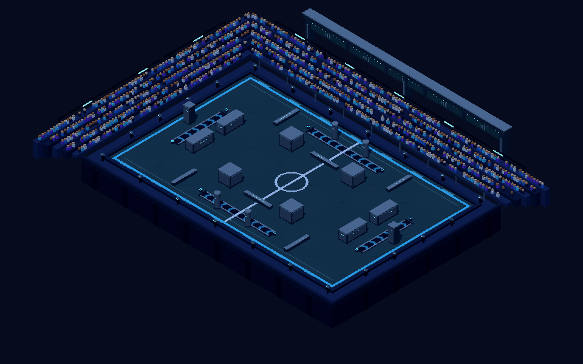
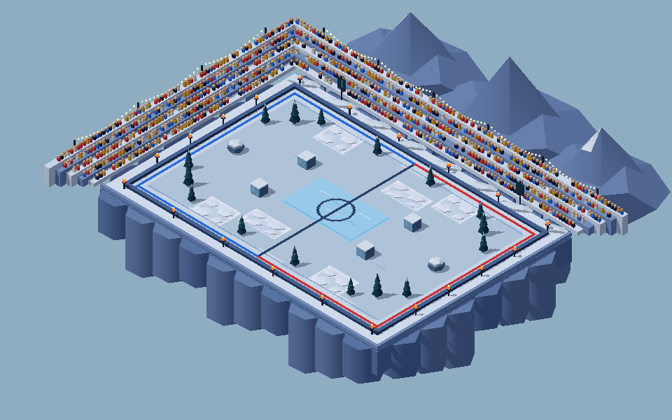

<div align="center">

# GHOST · BALL

**Pass it on. Don't be holding it at the buzzer.**

Isometric football survival. Six original strikers, animated abilities and arenas with terrain that changes the play.

**6 STRIKERS · 12 SKILLS · 6 ITEMS · 4 ARENAS · 5 MODES**

[**Explore the showcase ↗**](https://ghost-ball-art-direction.phucledien.chatgpt.site) · [**Play the game ↗**](https://ghost-ball-art-direction.phucledien.chatgpt.site/play/) · [Run locally](#run-locally) · [Art pipeline](docs/ART_PIPELINE.md)



**Web prototype · Vite 5 + Three.js r169 · iOS / iPadOS planned**

The hosted Site currently requires access. Everything can also be explored locally.

</div>

## Explore the game

The interactive showcase uses the same character rigs, arenas, audio and VFX as the game. Pause an animation, slow it down, scrub through its frames or inspect it in phone framing.

| Section | What you can try |
|---|---|
| [Characters ↗](https://ghost-ball-art-direction.phucledien.chatgpt.site/#characters) | Six strikers, ten animations, facing controls and hair, eyewear, headwear, boots, accessories and kit customization |
| [Sounds ↗](https://ghost-ball-art-direction.phucledien.chatgpt.site/#sounds) | 22 sound effects, two music loops, separate volume controls and stop controls |
| [Item VFX ↗](https://ghost-ball-art-direction.phucledien.chatgpt.site/#items) | All six items, activation-to-expiry playback, arena backdrops and duration feedback |
| [Skills ↗](https://ghost-ball-art-direction.phucledien.chatgpt.site/#skills) | Twelve casts with their windup, impact and recovery; replay at 0.25–2× speed |
| [Arenas ↗](https://ghost-ball-art-direction.phucledien.chatgpt.site/#arenas) | Four actual game layouts, orbit and tactical cameras, zoom and direct match links |

Skill previews inspect poses and effects. Use the match links to test targeting, collisions and tactical behavior. The [original art plan](https://ghost-ball-art-direction.phucledien.chatgpt.site/plan.html) keeps the production history, concepts and review evidence.

## How it plays

A crowd of strikers, a ball and a round clock. Pass the danger to someone else before time runs out.

- **Holding the ball at the buzzer:** you're out.
- **Ball loose or in flight:** its last kicker is out.
- **Last striker standing:** wins.

A short catch lock and a restriction on passing straight back prevent endless ping-pong. Roster size changes with the selected mode and arena.



The HUD distinguishes **last touch** from **out if buzzer**—a shield deflection can make those different players. Active item bars show remaining duration; Magnet stays ready until a targeted pass consumes it. Keyboard presses are buffered across short recovery and impact pauses so movement and abilities can be combined.

### Modes

| Mode | Twist |
|---|---|
| **Ghost Ball** | One ball, one visible round clock |
| **Hot Fuse** | A fuse burns faster while held; a loose ball drifts back toward its kicker |
| **Twin Ego** | Two balls, a larger pitch and more players |
| **Last Field** | The pitch shrinks after eliminations |
| **Sudden Death** | A hidden, variable clock |

### Controls

| Action | Touch | Keyboard / mouse |
|---|---|---|
| Move | Joystick | WASD / arrows |
| Pass with ball / dash without | A; hold to charge, drag to aim | J / Space / left click |
| Attack with ball / defense without | B | K / Q / right click |
| Use item | C | L / E |
| Pause | Pause button | Esc |

## Meet the strikers

Each hero has a passive, an attack and a defense. All six use authored Blender masters with articulated feet, distinct proportions and signature outfits. Cosmetics stay on these new rigs in the character preview, roster portrait and match.

| Striker | Role | Attack · with ball | Defense · without ball |
|---|---|---|---|
| **NOVA** · The Architect | Playmaker | **Direct Volley** — fast, leading pass | **Field Read** — speed burst and visible pass lanes |
| **BOLT** · The Panther | Speedster | **Blitz Carry** — rush with the ball and tag a rival | **Panther Leap** — jump over incoming passes |
| **TITAN** · The King | Bruiser | **Predator Cannon** — stunning, forceful pass | **Rampart** — raise a stone wall |
| **JINX** · The Monster | Trickster | **Phantom Pair** — send the ball with decoys | **Feint Step** — short blink |
| **ECHO** · The Trapper | Genius | **Curve Ghost** — bending, homing pass | **Perfect Trap** — parry and return the ball |
| **KAIZ** · The Emperor | Assassin | **Emperor Impact** — teleport behind a rival and strike | **Crown Guard** — reflect the ball with a shield |

| Character inspector | Skill animation |
|:-:|:-:|
|  |  |

The [Art Lab](art.html) compares original geometry, current live rigs and **2,880 baked frames**: six heroes × ten actions × eight facings × six frames. Editable `.blend` and layered `.aseprite` sources live in [`art/source`](art/source). Gameplay uses the live rigs; the baked signature-outfit sheets remain inspectable art assets.

## Effects you can read

Casts gather energy before release, snap into bright impacts and leave fading secondary motion. Shields assemble from facets, cleats stream wind from the ankles, ice rises around frozen players and ball trails follow the actual flight path. The renderer keeps hard edges and clear silhouettes without bloom.



| Item | Effect | When it ends |
|---|---|---|
| **Spring Cleats** | Boost movement speed | Timer expires |
| **Ego Shield** | Reflect the next ball | One block or timeout |
| **Magnet Lace** | Guide your next targeted pass | That pass consumes it |
| **Cloak Flare** | Break bot targeting and aim assist | Timer expires; loose balls can still hit you |
| **Freeze Whistle** | Freeze nearby rivals | Their short freeze timer expires |
| **Overclock** | Reset dash and both skill cooldowns | Instant confirmation |

The [generated direction sheet](art/reference/vfx-direction-v8.png) and [exact prompt](art/reference/vfx-direction-v8-prompt.txt) document the visual starting point. Runtime effects are authored, animated Three.js geometry. The concept image is not a gameplay screenshot or a shipped spell sprite.

## Choose your ground

| Sun Temple Ruins | Ego Lab Complex | Frost Peak |
|:-:|:-:|:-:|
|  |  |  |
| 40 × 26 · Pillars, low walls, sand and grass | 44 × 28 · Crates, hurdles and boost lanes | 42 × 28 · Pines, ice rink and snowdrifts |

The **Training Pitch** provides an open court with configurable size and theme. Cover blocks runners and low passes; a charged lob can clear low walls. Sand and snow slow movement, ice changes grip, boost lanes accelerate you and tall grass disrupts distant targeting.

## Art direction & phone clarity

- **Live 3D, crisp pixels:** authored low-poly characters and faceted arenas, nearest-neighbor display and a camera snapped to the render grid. Phones default to full CSS-resolution rendering; pixel size remains selectable.
- **Readable action:** synchronized kick/catch poses, articulated running feet, distinct ability silhouettes and a gold outline for the local player behind cover.
- **Focused interface:** compact mode selection, actual arena previews, separate ball history indicators and item names, effects and countdowns.
- **Two complementary interfaces:** the game uses Silkscreen and Pixelify Sans; the showcase uses locally bundled Barlow Condensed and DM Sans, with dark slate panels and gold controls.
- **Original procedural audio:** WebAudio synthesizes effects and the menu/match music. Audio begins after a user gesture.

See the [art pipeline](docs/ART_PIPELINE.md) for authoring, export, renderer decisions and validation. The [design document](docs/GAME_DESIGN.md) records the game rules and systems.

## Run locally

```sh
npm install
npm run dev
```

Open **http://localhost:5173**. Bun is also supported: `bun install` and `bun run dev`.

| Route | Purpose |
|---|---|
| `/` | Game, setup flow, settings and matches against bots |
| `/showcase.html` | Interactive characters, sounds, items, skills and arenas |
| `/art.html` | Original / master / sprite comparison and animation inspection |
| `/editor.html` | Live tuning editor and Skill Lab |
| `/sheet.html` | Game design sheet rendered from current configuration |
| `/device.html` | Three-arena, 14-player, two-ball performance check |

Jump into a match with `/?autoplay=1&hero=titan&map=temple`. Optional modes are `fuse`, `twin`, `shrink` and `sudden`; `demo=1` lets a bot drive your striker.

```sh
npm run build
npm run preview
```

On macOS, build output defaults to `~/Library/Developer/CodexBuilds/ghost-ball/dist`, with Vite's cache alongside it. Other platforms, including Cloudflare's Linux builders, use `dist/` and `node_modules/.vite/`. Override with `GHOST_BUILD_DIR` and `GHOST_VITE_CACHE` when needed; local artifacts must stay in a real local directory outside iCloud Drive.

### Deploy to Cloudflare

Use the repository root and `bun run build` as the build command. For **Pages**, set the build output directory to `dist`. For **Workers Builds**, use `npx wrangler deploy` as the deploy command. The committed `wrangler.jsonc` serves `dist/` as static assets and skips Wrangler's framework auto-configuration. Its Worker name is `ghost-ball`; if your existing Cloudflare Worker has another name, update the config to match. The game requires no server-side runtime; all six HTML entry points and their assets are included in the build.

To check deployment locally on macOS after building, run `npx wrangler deploy --dry-run --assets "$HOME/Library/Developer/CodexBuilds/ghost-ball/dist" --outdir "$HOME/Library/Developer/CodexBuilds/ghost-ball/wrangler-dry-run"`. The asset override points Wrangler at the local Mac build folder; Cloudflare uses the configured `dist/` folder.

The committed lockfile is verified with Bun **1.2.15**. Set the Cloudflare build variable `BUN_VERSION=1.2.15` to use that version. Keep Cloudflare's frozen install enabled: after changing dependencies, run `bun install`, commit both `package.json` and `bun.lock`, then verify `bun install --frozen-lockfile` before pushing.

See Cloudflare's [build environment settings](https://developers.cloudflare.com/workers/ci-cd/builds/build-image/) and [static asset deployment guide](https://developers.cloudflare.com/workers/static-assets/get-started/). The editor's **Lock** API is available only on the local development server; hosted builds support **Copy JSON** instead.

### Tune the game

The editor's **Skill Lab** runs real gameplay actions with phase timelines, slow motion, camera views and locked-versus-draft comparisons. Its **Live Match** view lets you play while adjusting values.

Drafts stay in browser storage and sync to open game/design-sheet tabs. **Lock** writes `config/locked.json` and a timestamped history entry through the dev server. Outside the dev server, use **Copy JSON**. The [design sheet](sheet.html) exposes the game's current tokens, components, icons and HUD.

### Project structure

```text
src/engine/       Renderer, hero rigs, animation, arenas, VFX and audio
src/game/         Rules, heroes, skills, items, input, maps and simulation
src/ui/           HUD, menus, portraits, icons and game styles
src/pages/        Game, showcase, Art Lab, editor, design sheet and device check
src/editor/       Tuning controls and Skill Lab
art/source/       Editable Blender and Aseprite masters
art/specs/        Camera, palette and animation specifications
art/reference/    Generated VFX direction and its exact prompt
public/assets/    Sprite atlases, model previews, map images and showcase fonts
tools/art/        Authoring, export and verification scripts
docs/             Game design and art pipeline
```

## Status & next steps

The browser prototype includes the full setup flow, six customizable strikers, five modes, four arenas, six items, animated VFX, audio and an interactive asset showcase. The art checks cover rig/frame alignment, cosmetics, item lifecycles, cast timing, input buffering and responsive layouts.

The revision-8 production run in **desktop Chromium at phone size** recorded **16.7–16.8 ms median / 33.4 ms p95** across three arenas with 14 players and two balls. This meets the provisional 30 fps target; it is not a physical-iPhone measurement. Run `/device.html` on the device you want to assess.

Next: physical iPhone/iPad playtests, balance tuning, haptics, bundling the remaining game fonts and a Capacitor/TestFlight build. Online multiplayer remains future work.

<details>
<summary>Early prototype videos</summary>

These clips predate the current art and showcase. They document the original prototype rather than the latest appearance.

[Gameplay](media/ghost-ball-game.mp4) · [Editor](media/ghost-ball-editor.mp4) · [Design sheet](media/ghost-ball-sheet.mp4)

</details>
