<div align="center">

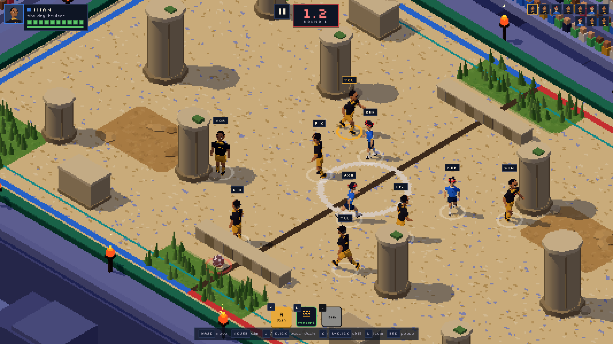

# GHOST · BALL

**Pass it on. Don't be holding it at the buzzer.**

A pixel-isometric football survival game with hero skills, items and a live tuning editor.<br>
Web prototype (Vite + three.js) for an iOS / iPadOS game.


[Showcase videos](#showcase) · [Menus](#menus--match-setup) · [How it plays](#how-it-plays) · [Heroes](#heroes) · [Editor](#the-editor) · [Design system](#design-system) · [Run it](#run-it) · [Design doc](docs/GAME_DESIGN.md)

</div>

---

## Showcase

| Game | Editor | Design sheet |
|:-:|:-:|:-:|
| [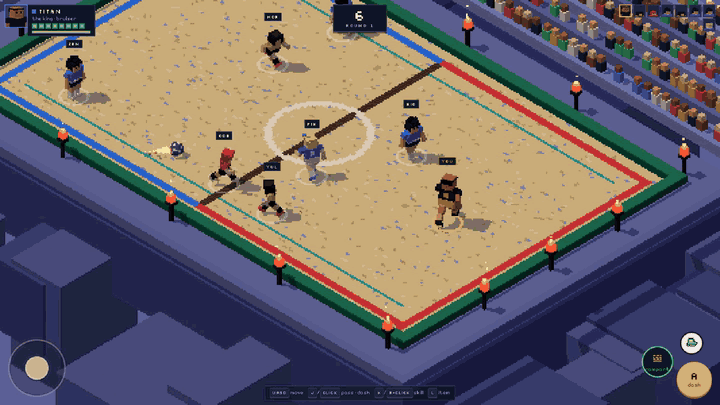](media/ghost-ball-game.mp4) | [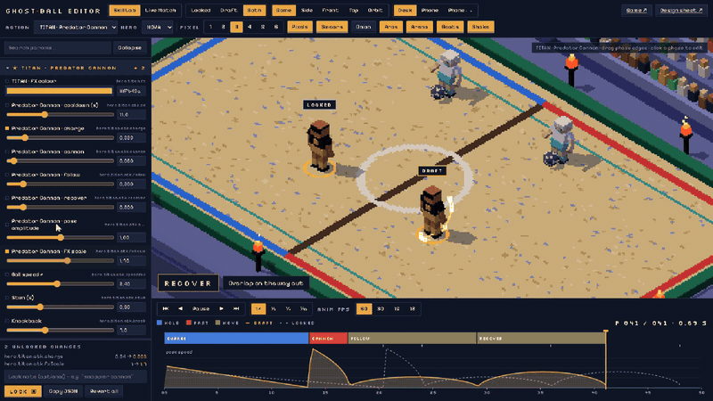](media/ghost-ball-editor.mp4) | [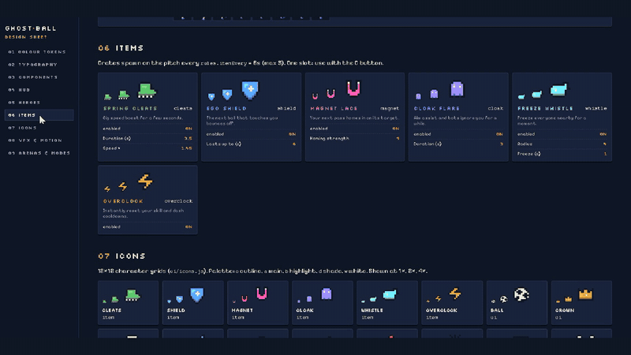](media/ghost-ball-sheet.mp4) |
| [▶ Watch (58s)](media/ghost-ball-game.mp4) | [▶ Watch (62s)](media/ghost-ball-editor.mp4) | [▶ Watch (62s)](media/ghost-ball-sheet.mp4) |

---

## Menus & match setup

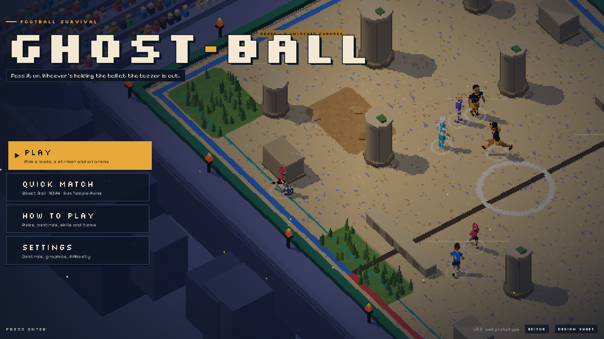

A live bot match plays behind every menu. **Play** walks through three steps, like a kart-racer select:

| 1 · Mode | 2 · Striker | 3 · Arena |
|:-:|:-:|:-:|
| 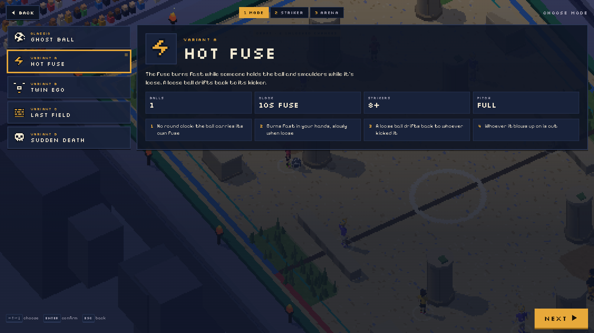 | 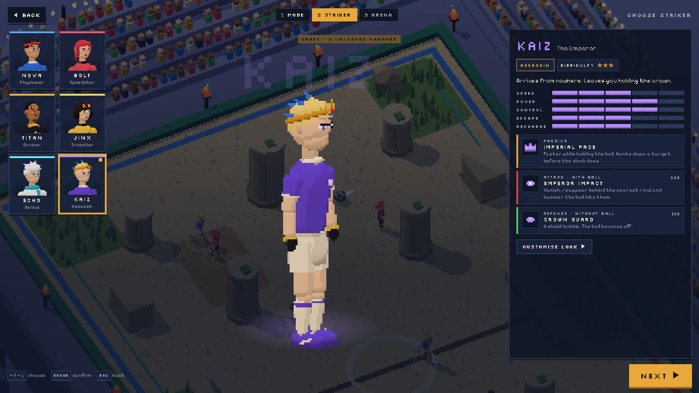 | 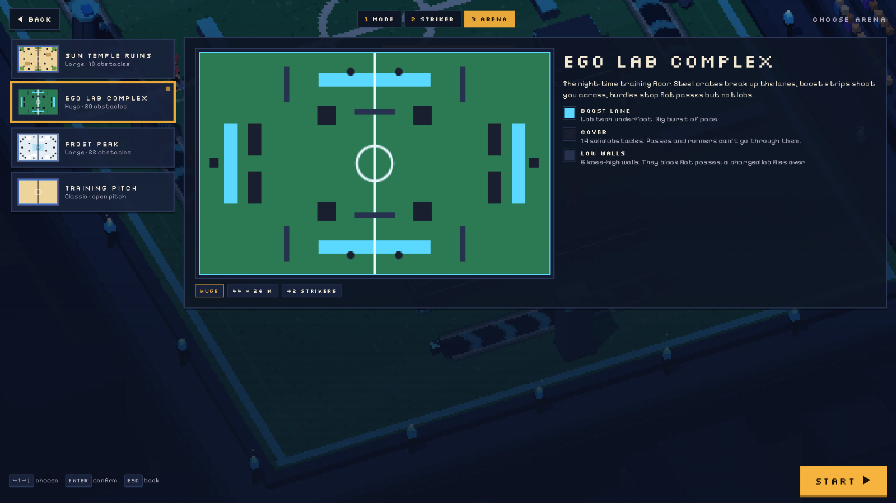 |
| Rules, ball count, clock, roster size | Turntable preview playing the hero's skill, stat bars, difficulty, all three skills | Top-down map, size, cover and terrain legend; the background switches arena |

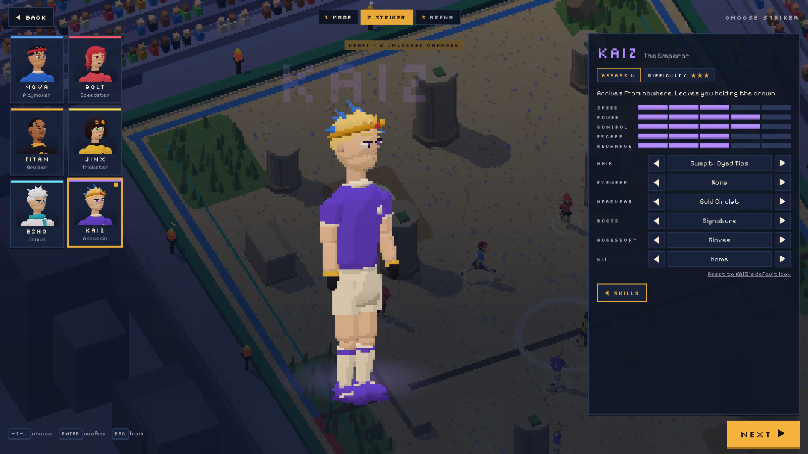

**Customise look** gives each striker hair, eyewear, headwear, boots, an accessory and a kit colourway, saved per hero. Also: Quick Match (your last picks), How to Play, Settings (controls, sound, graphics, difficulty, round length), pause, and a results screen with your placing and match stats. Keyboard (arrows / Enter / Esc) works on every screen.

**Sound** is fully procedural (WebAudio, no asset files): a menu groove and a faster match loop, plus effects for kicks, catches, skills, bounces, the buzzer and eliminations.

---

## How it plays

Eight strikers, one ball, a round clock. The ball sticks to whoever it touches.

- **Holding the ball when the buzzer goes:** you're out.
- **Ball loose or still in the air at the buzzer:** whoever kicked it last is out.
- **Last striker standing:** crowned the egoist.

To stop endless ping-pong, a new receiver has a short catch lock before they can pass, and can't pass straight back to whoever just passed to them.

| | With the ball (**attacker**) | Without the ball (**runner**) |
|---|---|---|
| **A** | Pass. Hold to charge, drag to aim | Dash |
| **B** | Attack skill | Defense skill |
| **C** | Item | Item |

### Modes

| | Mode | Twist |
|---|---|---|
| CLASSIC | **Ghost Ball** | One ball, one round clock |
| VARIANT A | **Hot Fuse** | The fuse burns fast while held and smoulders while loose. A loose ball drifts back to its kicker |
| VARIANT B | **Twin Ego** | Two balls, more players, bigger pitch: two can drop per round |
| VARIANT C | **Last Field** | The pitch shrinks after every elimination |
| VARIANT D | **Sudden Death** | Hidden clock: the ball goes off anywhere between ½× and 1½× a round |

### Arenas

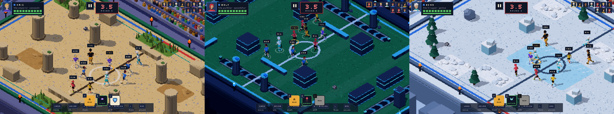

**Sun Temple Ruins** (40×26: pillars, low walls, sand pits, tall grass) · **Ego Lab Complex** (44×28: steel crates, hurdles, boost lanes) · **Frost Peak** (42×28: pine groves, ice rink, snowdrifts) · plus the open **Training Pitch**. Cover blocks runners and passes; low walls stop flat passes but not lobs. Details in [the design doc](docs/GAME_DESIGN.md#14-maps-terrain-and-the-front-end-v02).

### Built for phones

<table>
<tr>
<td width="32%">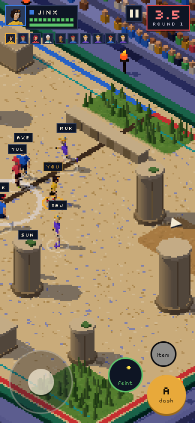</td>
<td>

- Controls follow the device: **joystick + A / B / C** on touch screens, key hints and an ability bar on desktop (override in Settings)
- The HUD reflows for portrait via container queries, the same in the editor's phone frame
- Safe-area insets, touch-first input, pixel scale tuned for mobile GPUs
- Plan for iOS: wrap the web build with Capacitor first (see the [design doc](docs/GAME_DESIGN.md))

</td>
</tr>
</table>

---

## Heroes

Original characters inspired by ego-striker anime archetypes. Each one has a **passive**, an **attack** skill (usable with the ball) and a **defense** skill (usable without it). Every skill is an animated action split into phases. Its effects fire on phase boundaries, and every phase is tunable in the editor.

| Hero | Role | Passive | Attack · with ball | Defense · without ball |
|---|---|---|---|---|
| **NOVA** · The Architect | Playmaker | Metavision: wider aim assist | **Direct Volley**: near-instant pass that leads the target | **Field Read**: burst of pace, every pass lane lights up |
| **BOLT** · The Panther | Speedster | Afterburn: always faster | **Blitz Carry**: dash with the ball, whoever you touch is IT | **Panther Leap**: passes sail underneath you |
| **TITAN** · The King | Bruiser | Royal Body: can't be stunned | **Predator Cannon**: charged pass that stuns and knocks back | **Rampart**: stomp up a stone wall |
| **JINX** · The Monster | Trickster | Inner Monster: shorter catch lock | **Phantom Pair**: real ball plus decoys | **Feint Step**: short blink |
| **ECHO** · The Trapper | Genius | Lazy Genius: cooldowns refill faster while still | **Curve Ghost**: bending, homing pass | **Perfect Trap**: parry window, the ball fires straight back out |
| **KAIZ** · The Emperor | Assassin | Imperial Pace: faster with the ball | **Emperor Impact**: teleport behind a rival, hammer it in | **Crown Guard**: shield bubble |

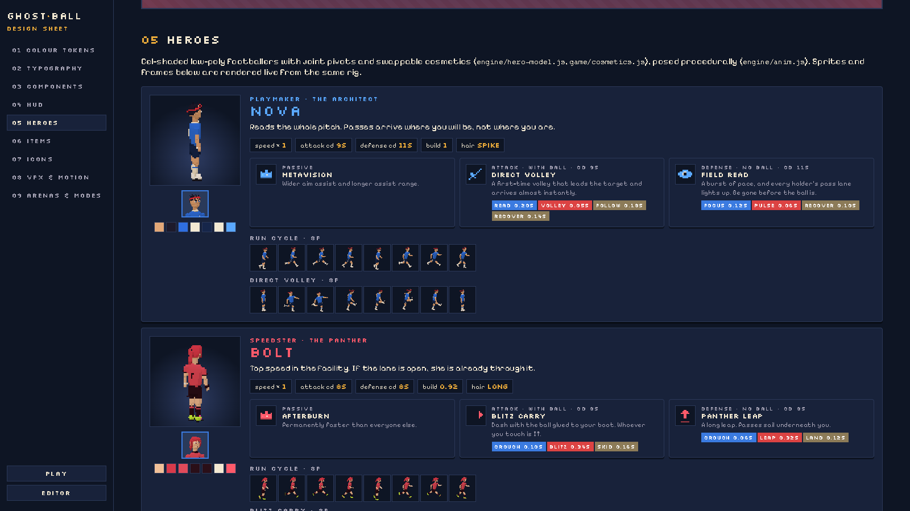

**Items** spawn on the pitch, one slot each: Spring Cleats · Ego Shield · Magnet Lace · Cloak Flare · Freeze Whistle · Overclock.

---

## The editor

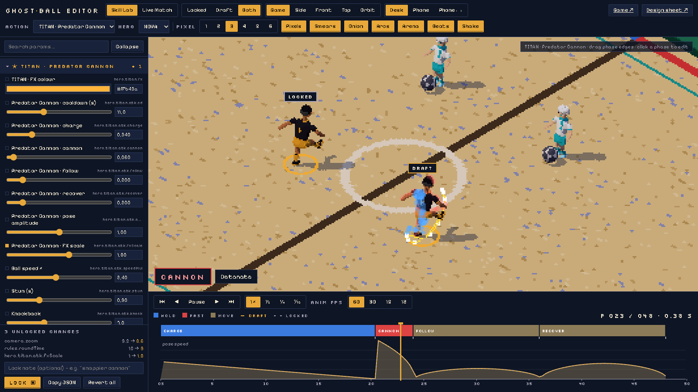

An animation and tuning editor modelled on a game-feel workflow. Every number in the game has a slider here, and changes apply live.

- **Skill Lab** loops any action on the real gameplay code: kick, ball flight, catch, walls, effects
- **Timeline:** HOLD / FAST / MOVE phases with draggable edges, a pose-speed curve, frame readout, ½ ¼ ⅒ speed, stepped 60 / 30 / 15 / 12 fps animation
- **Locked · Draft · Both:** run your locked values next to your edits
- **Views:** Game / Side / Front / Top / Orbit, plus Desk / Phone / Phone-landscape frames
- **Overlays:** onion skins, foot arcs, smears, phase captions, arena or grid floor, shake on/off
- **Live Match:** play or spectate a real match with the HUD while you tune, including UI colours and sizes
- **Lock** writes `config/locked.json` plus a timestamped history entry with your note

### Tuning loop

```
 editor  ──►  draft (saved in your browser, synced live to open game + sheet tabs)
                │
                ▼
              LOCK  ──►  config/locked.json  +  config/history/<time>.json
                │
                ▼
   "apply my locked config"  ──►  Claude bakes the values into the code defaults
```

Lock needs the dev server. Elsewhere, use **Copy JSON** and paste it to Claude.

---

## Design system

Everything in the design sheet (`/sheet.html`) is rendered by the game's own code from the live config, so it can't drift from the game.

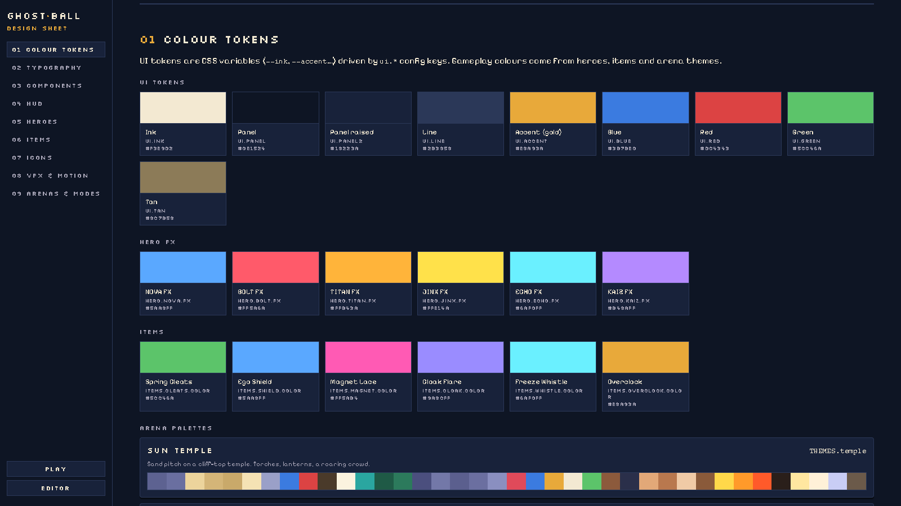

### Colour tokens

| Token | Hex | | Use |
|---|---|---|---|
| `ui.panel` | `#0e1524` |  | Background, panels |
| `ui.panel2` | `#18223a` |  | Raised surfaces, cards |
| `ui.line` | `#2b3858` |  | Borders, dividers |
| `ui.ink` | `#f3e9d2` |  | Text |
| `ui.accent` | `#e8a93a` |  | Active chips, primary actions, A button |
| `ui.blue` | `#3b7be0` |  | **HOLD** phases, team blue |
| `ui.red` | `#dc4343` |  | **FAST** phases, danger, "IT" |
| `ui.tan` | `#8c7b58` |  | **MOVE** phases |
| `ui.green` | `#5cc46a` |  | Ready, defense skills |

### Typography

| Role | Face | Used for |
|---|---|---|
| Display | **Silkscreen** | Logo, labels, timer, tags (uppercase, wide tracking) |
| Body | **Pixelify Sans** | Descriptions, captions, buttons |

Both come from Google Fonts. Bundle them locally for the iOS build.

### Components & HUD

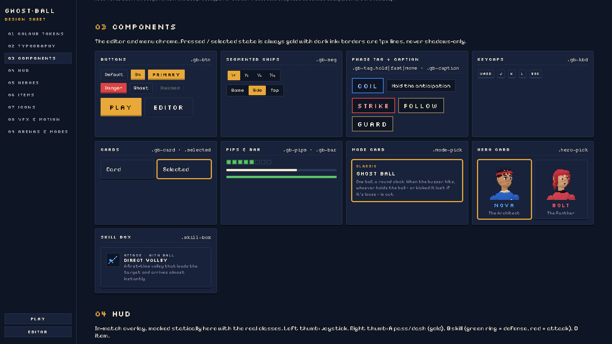

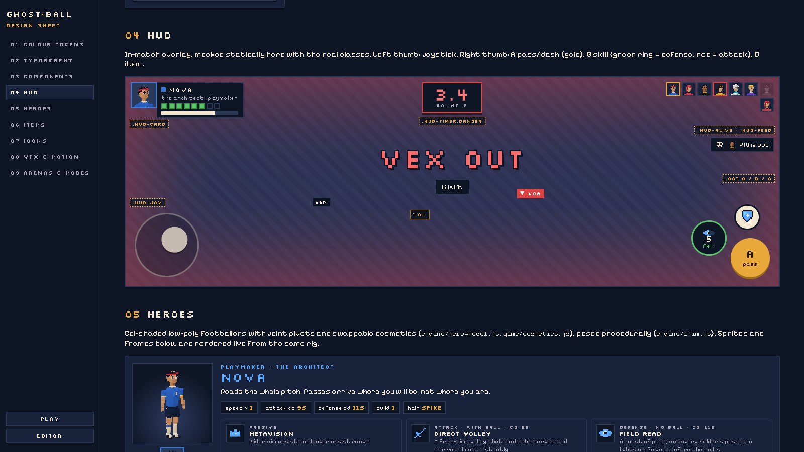

### Icons

12 × 12 pixel icons for items, skills and UI, drawn from character grids in `src/ui/icons.js`.

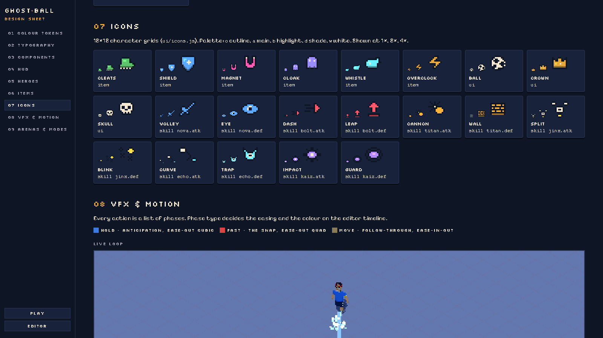

### The look

- **Pixel-isometric:** a real 3D scene (cel-shaded low-poly strikers, voxel arenas) rendered at ⅓ resolution and upscaled with `image-rendering: pixelated`, with the camera snapped to the texel grid so pixels don't shimmer
- **Game feel:** hitstop on catches, trauma² screen shake, flashes, slow-mo on eliminations, smears and afterimages, body-part shatter
- **Animation:** procedural poses blended through HOLD → FAST → MOVE phases, optionally stepped to 12–30 fps for a hand-animated feel

---

## Run it

```sh
bun install      # or: npm install
bun run dev      # or: npm run dev  →  http://localhost:5173
```

| URL | What |
|---|---|
| `/` | Game: menu, mode and hero select, matches against bots |
| `/editor.html` | Live tuning editor |
| `/sheet.html` | Design sheet |

The game opens on a title screen: **Play** walks you through Mode → Striker → Arena, with **Quick Match**, **How to Play** and **Settings** alongside.

URL options for the game: `?autoplay=1` skips the menu, `&hero=titan`, `&mode=fuse|twin|shrink|sudden`, `&map=temple|egolab|frost|pitch`, `&demo=1` lets a bot drive your striker.

### Controls

| | Touch | Keyboard / mouse |
|---|---|---|
| Move | Joystick | WASD / arrows |
| **A**: pass (with ball) / dash (without) | A: hold to charge, drag to aim | J / Space / left click (aims at cursor) |
| **B**: skill | B | K / Q / right click |
| **C**: item | C | L / E |
| Pause | ‖ button | Esc |

---

## Project structure

```
index.html / editor.html / sheet.html   page entries
vite.config.js        multi-page build + /api/config lock endpoint (dev)
config/locked.json    locked tuning values (written by Lock)
config/history/       one snapshot per Lock
docs/GAME_DESIGN.md   full design doc
media/                showcase videos + README images
src/core/             schema (every tunable) · config (defaults < locked < draft, live sync)
src/engine/           stage (iso camera, pixel scale) · arena · themes · hero rig · poses · VFX · props · audio
src/game/             heroes · cosmetics · skills · sim (rules, ball, rounds) · ai · input · items · modes · maps
src/ui/               design system CSS · tokens · HUD · menus · map schematics · pixel icons · portraits
src/editor/           Skill Lab + editor chrome
src/pages/            game · editor · sheet entry scripts
```

## Roadmap

- [x] Web prototype: game, editor, design sheet
- [ ] Playtest pass, balance from locked configs
- [ ] Capacitor wrap → TestFlight on iPhone / iPad
- [x] Title, match setup, settings, pause, results
- [x] Bigger maps with cover and terrain
- [x] Procedural music and sound effects
- [ ] Haptics, bundled fonts
- [ ] Online multiplayer

<div align="center">
<sub>Built with Claude Code · Original characters, no anime IP</sub>
</div>
